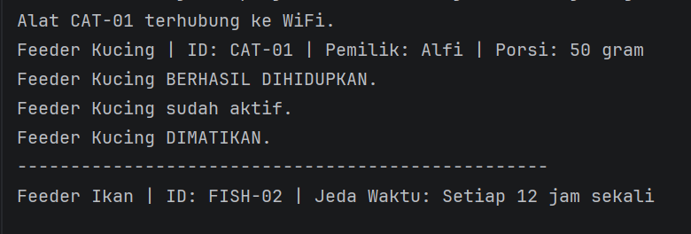

# Responsi Akhir PBO - IoT-Based Automated Pet Feeder System (Smart Pet Feeder)

## 1. Identitas Mahasiswa & Tema NIM
* **Nama** : Alfiatur Rofiqoh
* **NIM**  : H1D025055
* **Tema** : IoT 

## 2. Petunjuk Compile dan Run

1. Buka terminal atau Command Prompt di folder proyek.
2. Kompilasi seluruh kode sumber Java ketik :
   javac *.java (lalu setelah itu ketik)
   java MainMesinPakan

## 3. Luaran Program
